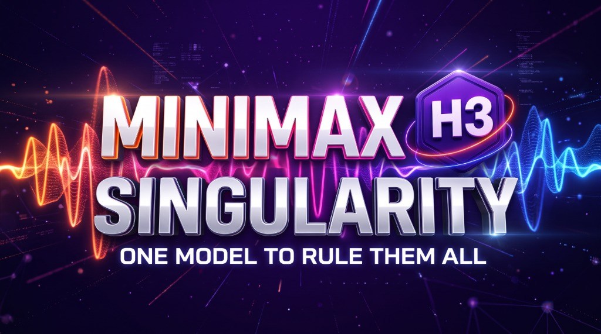
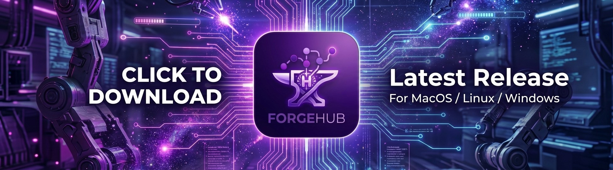

# MiniMax H3 Turbo — ComfyUI Serverless Worker

[](https://console.runpod.io/hub)

A production-ready [Runpod Serverless](https://docs.runpod.io/serverless/overview) worker running **MiniMax H3** (Comfy-Org INT8 ConvRot) on ComfyUI — text/image/first-last-frame/reference-to-video **with audio**, multi-scene **storyboards via the Director**, **H3-Image stills** (T2I + Edit), distilled turbo checkpoints, TensorRT RIFE + upscaling, wildcards and an uncensored Qwen3-VL enhancer. Built for [ForgeHub](https://github.com/huchukato/ForgeHub), but the endpoint speaks plain Runpod API.

## Deploy

1. **Storage first**: create a [network volume](https://console.runpod.io/user/storage) (≥160GB) in a datacenter with 96GB Pro GPUs — e.g. `US-NE-1`.
2. Click **Deploy** → endpoint → **Edit** → set **Max workers = 1** + attach your volume. Cold start is heavy (~120GB of models on first boot), so keep one warm worker — Runpod's default of 3 cold workers loses every time. No volume = every job fails on missing models.
3. Call it via the Runpod API or ForgeHub below — workflows, wildcards, job queue and outputs included; paste your API key and it detects the endpoint by itself.

[](https://github.com/huchukato/ForgeHub/releases/latest)

## Workflows included

| Workflow | Description |
| --- | --- |
| `MiniMaxH3-Turbo-T2VA.json` | Text → video + audio |
| `MiniMaxH3-Turbo-I2VA.json` | Image → video + audio |
| `MiniMaxH3-Turbo-FL2VA.json` | First/last frame → video + audio |
| `MiniMaxH3-Turbo-R2VA.json` | Reference images → video + audio |
| `MiniMaxH3-Singularity-R2VA.json` | Singularity fusion — up to 3 ref images + ref video |
| `MiniMaxH3-Director-Native.json` | **Director**: character sheet + one idea per line → multi-scene storyboard with audio; auto-analyzes subject + expands ideas via built-in QwenVL |
| `MiniMaxH3 Image - Txt2Img.json` | **H3-Image T2I**: text → still (6-step CFG-1, QwenVL enhancer presets, wildcards, native res up to 16MP) |
| `MiniMaxH3 Image - Edit.json` | **H3-Image Edit**: source image(s) + instruction → edited still |
| `RelayVSR-x2.json` | **Video x2 upscale**: RelayVSR 1-step DiT + Flash VAE — any clip, exact 2x, audio passthrough |

## Requirements

- **GPU**: 96GB class (`BLACKWELL_96` pool). The 32B text encoder + two video DiTs + TensorRT engines need the headroom.
- **Network volume**: ≥160GB at `/runpod-volume`. Models auto-download from `models-manifest.txt` (~120GB). Disable with `VOLUME_AUTOPOPULATE=false`.
- **CUDA**: 13.0+ hosts.

## Model stack (auto-provisioned)

- DiTs: `PRISM_DMAD_PDMD_int8` (Singularity×10Eros merge, R2VA/ref2va) + `Minimax-H3-Hybrid-DMAD-PDMD_int8` (FL2VA backbone + Ref2VA guidance) — 8-step distilled, no external turbo LoRAs
- H3-Image: `minimax_h3_image_pruned_int8_convrot` DiT + `minimax_h3_image_vae_fp16` VAE (`Comfy-Org/MiniMax-H3-Image`)
- Text encoder: `qwen3vl_32b_heretic_minimax_h3_nvfp4` (Momoking)
- Style LoRAs: `h3-realism-people` (fal), `h3_character_swap` (akatz), `mmh3-cinematic-lora-v2`
- VAEs: video fp16 + audio fp32, `taeh3` preview · Face detailer: `face_yolov8m` + `sam_vit_b`
- Enhancer LLM: Qwen3.5-9B Defiant-Fable NEO-MAX Q6_K GGUF + mmproj (also drives the Director's auto-Analyze/Enhance)

## Job input

```json
{
  "input": {
    "workflow": "MiniMaxH3-Director-Native.json",
    "prompt": "she turns from the window, hair catching the golden light\nshe walks toward the camera, playful smile",
    "global_prompt": "warm cinematic realism; her look stays the same in every shot",
    "seconds": 10,
    "images": ["<character sheet>"],
    "enhance": true,
    "video_size": "1344x768 (16:9)",
    "upscale": true,
    "rife": true
  }
}
```

- **Director Native**: `prompt` = one idea per line (each = a segment, `seconds` split evenly); `global_prompt` = style prose; `subject_description` optional (auto-Analyze when empty); `enhance` = per-segment QwenVL autoprompting (default true)
- Classic: `config` presets — `prism_r2va_turbo` (R2VA/Singularity/Director-Native) or `hybrid_fl2va_r2va_turbo` (T2VA/I2VA/FL2VA) — swap DiT/sampler/shift; `lora` = style LoRA on Singularity/Director-Native (`none`/`realism`/`char_swap`/`cinematic`), `lora_strength` = its strength (0–2, default 1.0)
- `video_size` — `auto` (follows the image/stills) or an explicit MMH3 native preset (`1344x768 (16:9)`, `1184x864 (4:3)`, …)
- **H3-Image** (`MiniMaxH3 Image - Txt2Img.json` / `Edit.json`): `image_size` picks a native still resolution (`2048x2048`, `3840x2176`, `5472x3072`, …); Edit takes `images` as source; `enhance`/`vl_preset` drive the QwenVL caption expansion; output is a single image
- **RelayVSR** (`RelayVSR-x2.json`): `video` = input clip (required); output is exactly 2x, frames/audio pass through — no prompt needed
- `upscale` / `rife` — TensorRT post chain · `"action": "health"` — status + workflow list, no generation

## Custom nodes baked in

`ComfyUI-VideoHelperSuite` · `ComfyUI-Easy-Use` · `ComfyUI-Impact-Pack` · `ComfyUI-Impact-Subpack` · `ComfyUI-QwenVL-Mod` · `ComfyUI-MiniMaxH3-Director-Enhanced` · `ComfyUI-RIFE-TensorRT-Auto` · `ComfyUI-Upscaler-TensorRT-Auto` · `ComfyUI-TagForge` · `ComfyUI-PerfectVideoResolution` · `ComfyUI-Pixaroma` · `ComfyUI-KJNodes`

## Companion stack

- 🖼 Image sibling: [huchukato/runpod-qwen21](https://github.com/huchukato/runpod-qwen21) (Qwen Image 2.1 T2I/Edit + Pony)
- 🎬 Video sibling: [huchukato/runpod-ltx-25](https://github.com/huchukato/runpod-ltx-25) (LTX-2.5 + Director)
- 🏠 App: [ForgeHub](https://github.com/huchukato/ForgeHub) — one UI for all endpoints
- 📦 Templates + provisioning: [ComfyUI-Garage](https://github.com/huchukato/ComfyUI-Garage)
- 🤗 QwenVL presets + wildcards sync from Garage at boot

*MIT licensed — MiniMax H3 weights are subject to their own license.*
